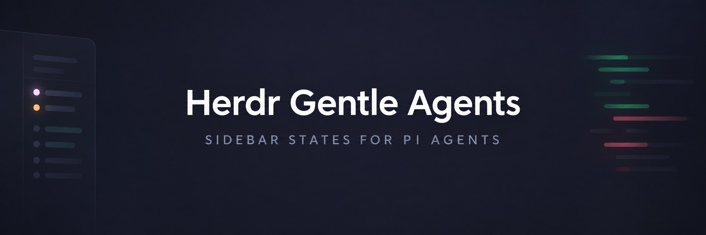
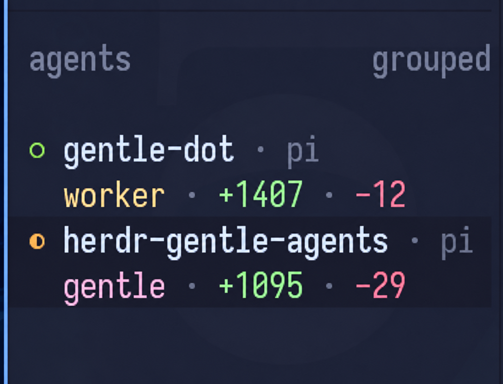

# Herdr Gentle Agents



Local Herdr plugin so the sidebar recognises Pi + Gentle Shell agents.

## What It Does

Reports per-pane agent state (`gentle` for generic activity — machine key
`working` — e.g. the orchestrator/main agent when settled with no fresh
root marker; `gentle` in pink while the principal
session actively works with no delegation active — even with zero
subagents — (machine display key
`orchestrating`, pink palette unchanged),
the active TaskStore role — `explorer`, `worker`, `verify`, `judge`, `rdd`
— with delegated subagents (the oldest running role shows over root
`gentle`, plus the total running count in parentheses only when above one),
`ask` (three independent event legs — choice, native questionnaire, legacy rpiv — plus
executed `ask_user_question`/`ask_user_choice` tool calls (execution opens, end/result closes;
proposals never block), tool-gated `ui_prompt` spans, and
permission waiting; `gentle_review` starts never speculate ask, amber/orange `?`), `blocked`, `done`, `idle`) plus compact
changes segments folded into the single row-1 heading cell (nonempty ` +N`/` -N`/` ↑N`
with leading spaces, symbols color-distinguished by `contains` rules: ` +` green for added,
` -` red for deleted, ` ↑` blue for pull — added stays green, deleted stays red),
reduced from `gentle_*`
pane-metadata tokens. It coexists with `herdr-pi-tree` through a single-writer handoff: while
this plugin owns a pane, `herdr-pi-tree` stays disabled for that pane, so the
two never share token names or the 16-token budget. Details live in
[DESIGN.md](DESIGN.md).

## What It Looks Like

<p align="center">
  
</p>

The Agents panel renders the active role (`worker`), the principal state (`gentle`),
and compact `+N` / `-N` change segments in one row per pane.

## Quick Start

Prerequisites: Linux, Node >= 18, Herdr meeting `min_herdr_version` in `herdr-plugin.toml`, and
`herdr-pi-tree` installed (it stays installed but disabled for gentle-owned
panes).

One script installs both halves: the Herdr plugin
plus a managed copy of `extensions/gentle-herdr-state.ts` at
`~/.pi/agent/extensions/gentle-herdr-state.ts`.

The stable entrypoint always resolves to the newest release, while each
release freezes its uploaded asset bytes — the URL moves forward, the bytes
it served for a given release never change.

Review the script before piping it to a shell — fetch the URL
(never `main`) and read it first. The installer never uses `sudo` and never
handles credentials.

### Public install (stable, one command)

```sh
curl -fsSL https://github.com/jonasotoaguilar/herdr-gentle-agents/releases/latest/download/install.sh | sh
```

With no `--ref` the installer resolves the newest release tag automatically.

### Pinned install (explicit tag)

```sh
curl -fsSL https://raw.githubusercontent.com/jonasotoaguilar/herdr-gentle-agents/v0.2.0/install.sh | sh -s -- --ref v0.2.0
```

Pass `--ref <tag>` to pin an older release instead of following latest.

What the installer does:

- Installs and enables the Herdr plugin at the resolved `--ref` (the newest
  release when `--ref` is omitted).
- Atomically copies `extensions/gentle-herdr-state.ts` from the Herdr-managed
  checkout into `~/.pi/agent/extensions/gentle-herdr-state.ts` (temp file plus
  rename) with a SHA-256 ownership record. A conflicting destination — including
  a locally modified managed copy, symlink, directory, or special file — is moved
  aside to a timestamped backup, never silently destroyed.
- Records the non-destructive force-exclusion `-extensions/herdr-agent-state.ts`
  in the global Pi settings (`~/.pi/agent/settings.json`, or `$PI_AGENT_DIR`
  when overridden) so the managed native base file stays on disk but is never
  auto-loaded next to our copy — one publisher. The entry is appended
  idempotently; unrelated settings and pre-existing exclusions are preserved,
  and invalid settings fail closed (the installer aborts without rewriting the
  file). Ownership is a bound record (exact entry plus canonical settings
  path): if the record cannot be written, the settings change is rolled back
  byte-identical, and if a later install step fails the exclusion is rolled
  back best-effort so the base is not left disabled with no replacement (a
  managed copy already written stays in place — re-run install to converge).
  Symlinked settings are updated atomically through the link with the link and
  mode preserved; fresh files are created 0600. Four limits: running Pi
  sessions still need `/reload` (or a restart) for the exclusion to take
  effect; an explicit project-level `extensions` entry can re-enable the base
  file for that project; a rollback that itself fails says so instead of
  claiming success; two agent dirs sharing one state dir fail closed on the
  second install — separate `XDG_STATE_HOME` or remove the stale record.
- Runs the managed Herdr sidebar `configure --apply` plus `--check`, then best-effort
  `herdr server reload-config` and best-effort daemon ensure via `bin/gentle-status.js`.
  Best-effort reload/daemon failures warn without rolling back the completed install
  and config. The `configure` action itself only writes the managed Herdr sidebar
  block described below.
- Running Pi sessions still need `/reload` (or a restart) to pick up the updated extension.

### Local development

Point Herdr at this checkout (from this directory). `herdr plugin link`
only registers this directory; it runs no build.

```sh
herdr plugin link --enabled .
herdr plugin action invoke configure --plugin herdr-gentle-agents
```

Then run `/reload` in Pi to pick up the local package.

For isolated/local use the installer honors a `PI_AGENT_DIR` override (default
`$HOME/.pi/agent`) without touching the live Pi dir, e.g.
`PI_AGENT_DIR=/tmp/pi-agent-test sh install.sh --ref v0.2.0`. Do not use
`pi install` as the production path for this installer — the managed copy at
`~/.pi/agent/extensions/gentle-herdr-state.ts` is the supported Pi half.

### Update

Re-run the same command — no tag lookup needed:

```sh
curl -fsSL https://github.com/jonasotoaguilar/herdr-gentle-agents/releases/latest/download/install.sh | sh
```

The installer compares the installed plugin version with the resolved target:
an older install updates, an already-current install is a no-op, and a newer
installed version aborts naming both versions unless `--allow-downgrade` is
given:

```sh
curl -fsSL https://github.com/jonasotoaguilar/herdr-gentle-agents/releases/latest/download/install.sh | sh -s -- --allow-downgrade
```

A modified managed Pi copy is backed up before replacement, same as on install.

If the installed plugin is locally linked, the remote install replaces it
automatically and warns naming the plugin id; to restore a checkout afterwards
re-link it:

```sh
herdr plugin link --enabled .
```

`--force` is deprecated and a no-op kept only so commands documented in v0.1.1
keep working; use `--allow-downgrade` for downgrades instead.

### Removal

```sh
curl -fsSL https://github.com/jonasotoaguilar/herdr-gentle-agents/releases/latest/download/install.sh | sh -s -- --uninstall
```

Uninstall runs `configure --uninstall`, best-effort daemon `--stop --purge` and
`herdr server reload-config`, then removes the Herdr plugin. The managed Pi copy
is ownership-checked: a locally modified `~/.pi/agent/extensions/gentle-herdr-state.ts`
is preserved with a warning, never deleted. The settings exclusion is likewise
ownership-checked: only the entry this installer added is removed, while a
pre-existing identical entry and unrelated settings are preserved. A foreign,
invalid, or misbound ownership record fails closed: uninstall warns, preserves
the entry, and still removes the plugin.

The `configure` action runs `node bin/configure.js --apply --reload`: it
appends one marked pi-only `[ui.sidebar.agents.rows_by_agent]` override for
canonical agent `pi` and reloads the server. Direct equivalents:

```sh
node bin/configure.js --check
node bin/configure.js --apply
node bin/configure.js --apply --reload   # apply + `herdr server reload-config`
node bin/configure.js --uninstall --reload
```

### Sidebar override (non-destructive, pi-only)

`bin/configure.js` manages only its marked block and never edits the
user-owned `[ui.sidebar.agents]` table it sits under. The managed override is
exactly two pi-only rows: row 1 is the native Herdr tokens `state_icon`,
`workspace`, `agent` in that order as plain native token strings (no custom
cells, no colors wired here — row-1 glyph and identity coloring, including
the native `state_icon`, is Herdr-native and not plugin-controlled); row 2
wires the eleven presence-encoded `gentle_title_*` state cells (state word
only, one current title per frame, each in its state's semantic color as
base fg with no rules; role words carry the total running count in
parentheses only when above one, e.g. `worker (2)`) followed by the three
change-segment tokens (added green `+N`, deleted red `-N`, pull blue `↑N`,
each its own color cell with no rules, never swapped). The review leg
renders the user-facing word `rdd` in blue `#89b4fa` (same as
explorer/pull; internal TaskStore role slug stays `rdd`, machine display key
and token names stay `review` — review execution is silent, never a
notification; only an actual waiting prompt renders `ask` with one
intervention notification per intent); the judge delegate role renders `judge` in
purple `#cba6f7` (distinct from explorer blue, verify teal, and
orchestrating pink); the error value renders `blocked`; the orchestrating
leg renders the user-facing word `gentle` (machine key stays
`orchestrating`, pink `#f5c2e7`). Remaining state colors:
working/worker amber `#f9e2af`, explorer blue `#89b4fa`, verify teal
`#94e2d5`, ask orange `#fab387`, error red `#f38ba8`, done green `#a6e3a1`,
idle grey `#7c7f93`. Added stays green and deleted stays red; the mapping
is never swapped. The custom `$gentle_heading_*` / `$gentle_project` /
`$gentle_agent` cells and `gentle_changes_summary` stay published and owned
for compatibility but are wired into no visible row.
Only one `gentle_title_*` token carries a value per frame (presence
encoding), so row 2 shows the current state word (role words with ` (n)`
only when the running total is above one) plus any nonempty change
segments while the rest render empty; native separators on row 2 are
acceptable. Row 1 holds 3 native cells and row 2 holds 14 cells (11 state
+ 3 changes), each within Herdr's 16-token per-row ceiling (full block below).

```toml
# BEGIN herdr-gentle-agents (managed; do not edit)
# Sidebar override owned by herdr-gentle-agents: two pi-only rows —
# row 1 native state_icon + workspace + agent, row 2 state word + changes.
# The parent [ui.sidebar.agents] table is user-owned and never touched here.
[ui.sidebar.agents.rows_by_agent]
pi = [["state_icon", "workspace", "agent"], [{ token = "$gentle_title_working", fg = "#f9e2af" }, { token = "$gentle_title_orchestrating", fg = "#f5c2e7" }, { token = "$gentle_title_explorer", fg = "#89b4fa" }, { token = "$gentle_title_worker", fg = "#f9e2af" }, { token = "$gentle_title_verify", fg = "#94e2d5" }, { token = "$gentle_title_judge", fg = "#cba6f7" }, { token = "$gentle_title_ask", fg = "#fab387" }, { token = "$gentle_title_review", fg = "#89b4fa" }, { token = "$gentle_title_error", fg = "#f38ba8" }, { token = "$gentle_title_done", fg = "#a6e3a1" }, { token = "$gentle_title_idle", fg = "#7c7f93" }, { token = "$gentle_changes_added", fg = "#a6e3a1" }, { token = "$gentle_changes_deleted", fg = "#f38ba8" }, { token = "$gentle_changes_pull", fg = "#89b4fa" }]]
# END herdr-gentle-agents
```

The
single row-1 heading cell mirrors the Gentle Shell SessionChanges model semantics
(write/edit tool outcomes, never `git status`, never an approximate
reaggregation): files keyed by `(root, path)` with snapshot-continuity and
unavailable counts (unavailable files stay in the file count with 0/0); `↑N` shows when the pane
branch is behind its upstream (branch-ab status only, no diff). `gentle_project`,
`gentle_changes_summary`, and the segment
tokens (`gentle_changes_added`/`_deleted`/`_pull`) stay published for
compatibility but render no visible row. `gentle`
renders for generic activity (machine key `working`): the main agent when settled with no fresh root marker or roles
(or active subs with an unsalvageable role shape and no fresh marker); pink
`gentle` (machine key `orchestrating`, pink palette unchanged) renders while the principal session actively works — even with zero subagents —
retaining running-subagent or pending-launch coverage (outranking generic
activity only, yielding to any recognized role, `ask`/`rdd`/`blocked` and
terminal `done` — where `done` needs settled-plus-empty (principal settled
with no running delegates and no pending launches; a settled principal with
running delegates keeps the oldest role, never `done`); the oldest running
TaskStore role (`explorer`, `worker`,
`verify`, `judge`, `rdd`) renders with delegated subagents plus the total
running count in parentheses only when above one (e.g. `explorer (3)` for
three explorers, `explorer (2)` for oldest-explorer-plus-worker, bare `worker`
for a single survivor) — never a subagent name; ask/error/idle/done/gentle
never suffix. The work total is a direct projection of the
Gentle Shell TaskStore `running` records (only `running` counts as
executing; queued/waiting never count), never a calculated
pending-call estimate: pending tool calls are role-only display hints (exact
in-flight subagent agent -> role slug, so task-mode launches show the active
role even at count 0) plus label correlation, and
true concurrent tasks all count. A live `running` record is never regressed
by a racy non-final status read (only the authoritative launch outcomes,
completions, and presence terminals move it), so principal activity with
live delegates keeps the oldest role; a sanitized unknown slug exactly
equal to `working` degrades to `gentle` (the bare word `working` never
renders).
Background launches (`subagent_run` with `mode: background`) announce
lifecycle over `message_end` custom results: an ACTIVE status promotes the
start into the tasks map like a task-mode record, so an active background
worker renders `worker`, not `gentle`.
Errors render as user-facing `blocked`.
Other agents are unaffected. `--apply` refuses (exit 2, no write) when an
unmanaged `rows_by_agent` override already exists; remove or rename it, then
re-run. Writes are atomic (temp file plus rename) with a backup at
`<config>.herdr-gentle-agents.bak`. The config path resolves exactly like
`bin/gentle-status.js` (`HERDR_CONFIG_PATH`, then `XDG_CONFIG_HOME`, then
the platform default).

### Verification

```sh
node --check bin/configure.js
node --check bin/gentle-status.js
HERDR_CONFIG_PATH=/tmp/herdr-fixture.toml node bin/configure.js --apply
HERDR_CONFIG_PATH=/tmp/herdr-fixture.toml node bin/configure.js --check
HERDR_CONFIG_PATH=/tmp/herdr-fixture.toml node bin/configure.js --uninstall
herdr plugin action invoke configure --plugin herdr-gentle-agents
herdr server reload-config
```

Live check: with the daemon running and the override applied, open a Pi pane
and confirm row 2 shows pink `gentle` (machine key
`orchestrating`) while
the principal session actively works — even with zero subagents —
(yielding to the oldest running role — `worker`,
`explorer`, `verify`, `judge`, ... — plus the total running count in
parentheses only when above one), row 1 shows
the single heading cell (`● <project>` plus ` +N`/` -N`/` ↑N` inline, zero `·`) after edits / when behind upstream; then `ask` on an open
question (choice / native-questionnaire / legacy event legs, executed `ask_user_question`/`ask_user_choice`, tool-gated `ui_prompt` spans, or permission waiting; `gentle_review` starts never speculate ask) and `blocked` on error. `rdd` (machine key `review`) applies during acknowledged native capture/group execution only (`reviewerRunAcknowledged: true` at execution start — never proposal, never forecast-only, never `correctionLines` planning, never `gentle_review`/`gentle_review_scope` in any operation; no hook/sidebar signal observed; unknown legacy shapes stay dark; call-id tracked so thrown/cancelled calls still clear, read-only `assess` excluded). Bounded approximation: the acknowledged interval contains preparation and admission; no exact reviewer internal events exist today. The orchestrator-host `ask_user_choice` prompt emits no Pi tool/event observable by this extension and stays covered only by the event legs above. Never point the fixture commands at the live config: keep
`HERDR_CONFIG_PATH` on a temp file for apply/uninstall checks.

## Core Workflow

A Pi sidecar extension publishes `gentle_*` tokens per pane; a plugin daemon
reduces the Herdr snapshot to sidebar state on a poll cadence. Same transport
and TTL discipline as `herdr-pi-tree`, new token names, no new socket or
webhook. `[[startup]] node bin/gentle-status.js` (no args) is the polling-daemon
bootstrap (ensures the adaptive poll daemon is running: 10 s baseline,
`GENTLE_STATUS_POLL_MS`-overridable, with a 2 s fast cycle while recent ask
activity or send/publish failures are observed); `[[events]] on =
"pane.agent_detected"` runs `node bin/gentle-status.js --once` as an immediate
one-frame refresh so a newly opened project name/state renders without waiting
for the next poll tick. See [DESIGN.md](DESIGN.md) §4 (producer) and §5 (consumer).

## Key Features You Should Know About

- Full v1 state matrix including the root-session `orchestrating` marker
  (pink `●` + user-facing word `gentle`, while the principal session actively
  works — even with zero subagents — retaining subagent/pending coverage;
  yielding to recognized roles, `ask`/`rdd`/`blocked` and terminal `done` (done
  needs settled-plus-empty);
  outranking generic activity (machine key `working`) only) and the authoritative TaskStore role signal
  (`explorer` / `worker` / `verify` / `judge` / `rdd` from `TaskRecord.agent`,
  oldest running first by immutable first-seen; `gentle` (machine key `working`) for
  generic activity (no delegation; an unknown delegation instead keeps its
  original sanitized name, 32-char bound — never a generic collapse), with the total running count in
  parentheses only when above one (`explorer (3)`, bare `worker` when single;
  ask/error/idle/done/gentle never suffix), `ask` on blocked user input,
  `rdd` during native review execution (machine key stays `review`; execution
  is silent — one notification fires only for a waiting `ask` intent), and
  user-facing `blocked` for errors.
- Single-cell row-1 heading (`<icon> <project>` plus ` +N`/` -N`/` ↑N`
  inline, exactly one nonempty cell so zero `·` separators; white base with
  `contains` rules keeping ` +` green (added), ` -` red (deleted,
  leading-space match), ` ↑` blue (pull)) mirroring the Gentle Shell
  SessionChanges model semantics over Gentle tool outcomes, never `git`
  status and never an approximate reaggregation (root+path continuity and
  unavailable counts); behind-upstream `↑N` from branch-ab status only.
  Session-change tokens are refreshed/cleared from the current Gentle Shell
  session model and never carried across sessions.
- Single-writer coexistence with `herdr-pi-tree`: no shared token names, no
  dual-write, scoped sweep of own tokens on handover.
- Always-on native owner (no opt-in flag): this extension is the single publisher of native `pane.report_agent` (`working`/`blocked`/`idle`) alongside its metadata beats, with session path-or-id binding, monotonic seq, and a serial latest-wins coalesced queue. Parity contract: `working` carries the specific working role in the message (oldest running role word — known short word, unknown sanitized name, or `gentle` with no delegation; never bare generic `working`; machine keys unchanged); terminal `idle` fires only on a truly empty settle (principal settled plus zero running/queued plus zero pending plus no human-wait prompt; settle-with-delegates/pending stays `working`, emitted once); `blocked` fires only for a real error or an actual human-wait intervention leg with its label (review/RDD execution stays `working`, silent). Our code never emits `done`/`finished` states or any notification method: the host owns finished text on `done`, `blocked`/unknown presentation, and sound; ask notification dedup stays consumer-side (one per intent). Single publisher by design: the managed native extension file is deleted and the user controls installs (no auto-restore) — never reinstall the native publisher from Herdr for the same pane (dual publishers collide). Limits (unverified, host-owned): the host `idle`→`done`→`finished` mapping and unknown-state handling are owned by Herdr.
- Delegation completion reconciled from Gentle Shell presence files, not chat
  delivery: a delegate resolves only from an explicit terminal status or a
  witnessed absence in a strictly newer verified activity generation of the
  same session, bound to an immutable per-task execution epoch (new launch,
  resume, or inactive-to-active transition — never a progress read or
  heartbeat tick). Ambiguous, stale, or oversize snapshots never clear
  tasks. Known limits: delegates that launch and finish between presence
  publications never appear and still depend on chat delivery, and
  absence-driven completion records `completed` without latching an error.
- TTL-bounded tokens: stale panes fall back to native `idle`.

## Documentation

| Your task | Start here |
| --- | --- |
| Protocol, token grammar, reducer, and coexistence rules | [DESIGN.md](DESIGN.md) |
| Compatibility, migration, and rollback | [DESIGN.md](DESIGN.md) §9 |
| Open decisions blocking implementation | [DESIGN.md](DESIGN.md) §10 |

## Next Steps

- Ship the Pi producer extension (`extensions/`) and the Herdr consumer daemon
  (`bin/`); the daemon ships, the sidebar override installs via the
  `configure` plugin action above.
- Resolve the open decisions in [DESIGN.md](DESIGN.md) §10 before implementing
  against them.
- Live sidebar eyeball with subagents/`ask` remains the final acceptance check
  (see Verification above).
